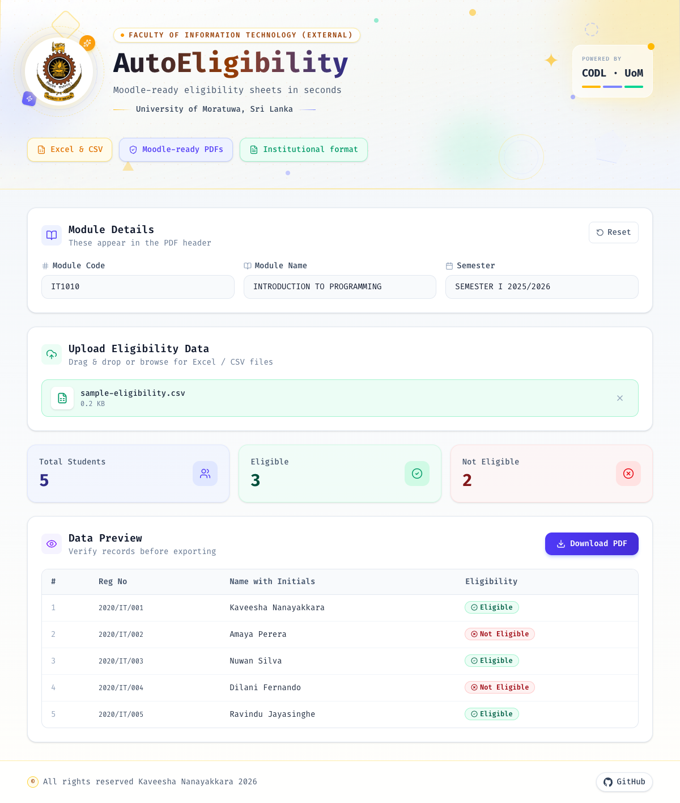

# AutoEligibility user guide

**Moodle-ready eligibility sheets in seconds**

AutoEligibility is a website for the **Faculty of Information Technology (External)**, **University of Moratuwa**. Staff use it to turn an Excel or CSV list of students into a formatted **CA + Exam eligibility PDF** that can be uploaded to Moodle.

Nothing is uploaded to a server. The spreadsheet is read in the browser, and the PDF is created on your computer.

**Open the site:** [https://kaveesl.github.io/AutoEligibility/](https://kaveesl.github.io/AutoEligibility/)

---

## What you see

The home page has three parts: the faculty header, the module details form, and the file upload area.


After you fill in the module and upload a spreadsheet, the page shows the student counts and a table you can check before downloading.



The sample file in that screenshot has **5** students: **3** eligible and **2** not eligible.

---

## How to use it

1. Open [AutoEligibility](https://kaveesl.github.io/AutoEligibility/).
2. Enter **Module Code**, **Module Name**, and **Semester**. Typed text is converted to uppercase, and these three lines appear in the PDF header.
3. Upload a `.xlsx` or `.csv` file. You can drag it onto the box or click **browse**.
4. Check the counts and the **Data Preview** table. Eligible rows are green. Not eligible rows are red.
5. Click **Download PDF**.

The file is saved as:

```text
{MODULECODE}-Eligibility List [CA+Exam].pdf
```

Example: `IT1010-Eligibility List [CA+Exam].pdf`

If a module field is empty, or no file has been uploaded, the page shows a message instead of downloading.

**Reset** clears the module fields. The **×** on the uploaded file removes that file and the preview.

---

## Spreadsheet format

The file needs three columns. Header names can vary. AutoEligibility matches similar labels.

| Field | Examples of accepted headers |
| --- | --- |
| Registration number | `Reg No`, `Registration No`, `Student ID`, `Index No` |
| Name | `Name with Initials`, `Name`, `Student Name`, `Full Name` |
| Eligibility | `Eligibility`, `Eligibility Status`, `Status` |

Eligibility values are not case-sensitive. Hyphens are treated as spaces, so `not-eligible` and `Not Eligible` both become **Not Eligible**.

A sample file is included in the repository:

```text
public/sample-eligibility.csv
```

```csv
Reg No,Name with Initials,Eligibility
2020/IT/001,Kaveesha Nanayakkara,Eligible
2020/IT/002,Amaya Perera,Not-Eligible
2020/IT/003,Nuwan Silva,eligible
2020/IT/004,Dilani Fernando,not-eligible
2020/IT/005,Ravindu Jayasinghe,Eligible
```

---

## What the PDF contains

| Section | Content |
| --- | --- |
| Header | University of Moratuwa logo |
| Institution | University of Moratuwa, Sri Lanka |
| Faculty | Faculty of Information Technology (External) |
| Module | Semester, module code, and module name |
| Table | Number, registration number, name with initials, eligibility |

Eligible rows use a light green background. Not eligible rows use a light red background.

---

## Privacy

The site has no login and no database. Your spreadsheet and the PDF stay on your device.
